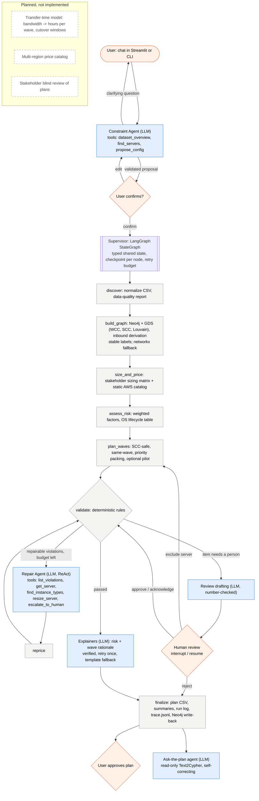

# P1 architecture (Milestone 2)

Design rule carried over from the stakeholder baseline and the Milestone 1 report:
**the language model interprets intent, chooses bounded actions, and explains;
deterministic tools compute graph structure, sizes, prices, risk scores, waves, and
validation.** Every LLM output is either validated by a tool (schemas, catalog
membership, capacity fit, ID existence) or verified against tool output (numbers,
names, risk factors) before it can influence the plan.

## Workflow (implemented vs planned)

Blue = LLM decision point, gray = deterministic tool, orange = human decision,
dashed = planned.

## What changed since Milestone 1 / the v0 prototype

| Area | v0 prototype (repo before M2) | P1 (M2) |
|---|---|---|
| Orchestration | Fixed list of subprocesses; failed stages still reported "complete" | LangGraph state machine with typed state, conditional routing, checkpoints, retry budget, interrupt/resume; non-zero exit on failure |
| Constraint interface | One-shot extraction, auto-confirmed, silent fallback to defaults; `target_cloud` ignored | Multi-turn agent grounds names in data with tools, asks when ambiguous, never confirms for the user; config drives cloud, limit, early requests, pilot |
| Validation | Run after export; never blocked anything | Gate inside the graph; violations routed to repair or human review |
| Recovery | Only a null-check for risk scores | Repair Agent with guarded tools; human review queue with drafted options |
| Risk | Binary rule; LLM assigned labels (22/40 wrong) | Weighted factors incl. dated OS end-of-life and inbound dependency impact; LLM only explains, verified |
| Waves | Strict-earlier readiness split every dependency; ID-dependent tie-breaks | Same-wave readiness, affinity/community/risk/savings priority, stable labels, optional pilot wave |
| Inbound dependencies | Computed but unused | Used in risk score (HIGH_INBOUND), pilot eligibility, explanations, Q&A |
| FinOps | 4-SKU catalog; 5 servers priced on undersized instances | 17 SKUs re-verified 2026-11-08; undersized servers repaired before pricing; license-not-included flags; right-sized what-if |
| Explanations | None | Per-server risk and per-wave rationale, fact-checked |
| Retrieval | `GraphCypherQAChain` with silent 10-row cut, write access | Read-only guarded tool, truncation reported, self-correction loop |
| Audit | Last 2,000 characters of stdout | `trace.jsonl` with every node, LLM call (model, prompt version, tokens, latency), tool call, verification, fallback |

## Agentic mechanisms

| Mechanism | When it runs | Reads | Updates | Effect on later steps |
|---|---|---|---|---|
| Constraint Agent (tool-using chat agent) | Before planning, every user turn | Chat history (memory), dataset via `dataset_overview` / `find_servers` | Proposed `RunConfig` (validated by `propose_config`) | Nothing runs until the user confirms; confirmed config sets wave limit, cloud, early servers, pilot |
| Supervisor (LangGraph) | Whole run | `P1State` | `P1State` after every node, checkpointed | Routes validate → repair / review / explain / finalize |
| Validator (verification) | After planning, after every repair and review | Plan, cleaned data, catalog, config, approvals | `validation` report, review items | Blocking violations prevent finalization |
| Repair Agent (ReAct) | When repairable violations exist and repair budget (3 rounds) remains | Violations, server specs, catalog | Size overrides, escalations | Plan is re-priced and re-validated; escalations go to human review |
| Review drafting | When items need a person | Item facts and allowed actions | Summary, suggestion, recommended action | Shown to the reviewer; the decision is the human's |
| Human review (HITL) | Interrupt after drafting | Open items | Decisions, approvals, exclusions | Approvals excuse violations; exclusions trigger re-planning; rejection stops the run |
| Explainers | After validation passes | Risk factors, wave facts with scheduling reasons | Verified explanations | Exported to plan CSV, `explanations.md`, UI |
| Q&A agent | On demand after a run | Plan graph in Neo4j (read-only) | Nothing | Answers questions; shows Cypher and rows |
| Fallbacks | Any LLM failure or `--no-llm` | Same inputs | Same outputs, flagged `template`/`fallback` | Pipeline always completes; fallbacks are counted in metrics |

## Models, frameworks, services

- LLMs via ASU Voyager (OpenAI-compatible): `qwen3-coder-30b-a3b-instruct` for all agents (same as the stakeholder baseline), `gpt-oss-120b` only for benchmark text generation, `qwen3-235b-a22b` for the model ablation. Temperature 0.
- LangChain 1.4 (`create_agent` tool loop, structured output), LangGraph 1.2 (`StateGraph`, `MemorySaver`, `interrupt`/`Command`).
- Neo4j 5 + Graph Data Science 2.13 + APOC (Docker, pinned image digest); networkx fallback.
- pandas, pydantic; Streamlit + Altair UI; matplotlib report figures; pytest.
- Static data: AWS On-Demand prices (instances.vantage.sh, read 2026-11-08), OS support dates (endoflife.date, read 2026-11-08).
