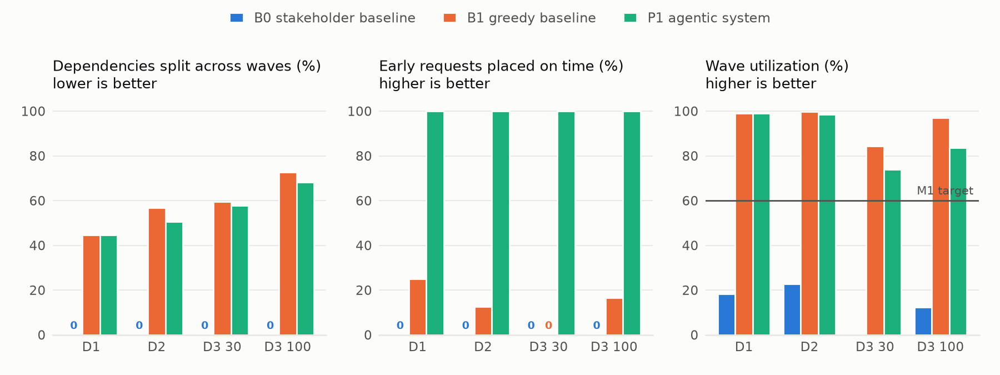

# Milestone 2 results

All numbers below are produced by `eval/run_eval.py`, `eval/eval_constraints.py`, and `eval/eval_qa.py` (raw rows: `results/eval_runs.json`; per-dataset tables: `results/eval_tables.md`; figures: `results/figures/`).
Every plan is scored by the same validator, with the same cleaned data and a 3,000 GB per-wave limit.

## Planning results (B0 stakeholder baseline, B1 greedy baseline, P1 agentic system)

| Dataset | System | Dep. violations | Waves >3 TB (unreported) | Undersized / non-AWS | Early on time % | Split deps % | Utilization % | Waves | Time s |
|---|---|---|---|---|---|---|---|---|---|
| D1 | B0 | 0 | 4 (4) | 5 / 0 | 0 | 0 | 18.3 | 19 | 129.4 |
| D1 | B1 | 0 | 4 (0) | 5 / 0 | 25 | 44.7 | 99.1 | 10 | <0.1 |
| D1 | P1 | 0 | 4 (0) | 0 / 0 | 100 | 44.7 | 99.1 | 10 | 307.7 |
| D2 | B0 | 0 | 1 (1) | 0 / 83 | 0 | 0 | 22.9 | 24 | 173.3 |
| D2 | B1 | 0 | 0 (0) | 0 / 0 | 12.5 | 56.9 | 99.7 | 13 | <0.1 |
| D2 | P1 | 0 | 0 (0) | 0 / 0 | 100 | 50.5 | 98.4 | 13 | 275.4 |
| D3_30 | B0 | 0 | 1 (1) | 0 / 30 | 0 | 0 | n/a | 2 | 151 |
| D3_30 | B1 | 0 | 0 (0) | 7 / 0 | 0 | 59.6 | 84.4 | 8 | 0.1 |
| D3_30 | P1 | 0 | 0 (0) | 0 / 0 | 100 | 57.7 | 73.9 | 9 | 79.1 |
| D3_100 | B0 | 0 | 2 (2) | 0 / 100 | 0 | 0 | 12.4 | 11 | 172.3 |
| D3_100 | B1 | 0 | 6 (0) | 21 / 0 | 16.7 | 72.6 | 97.1 | 21 | <0.1 |
| D3_100 | P1 | 0 | 6 (0) | 0 / 0 | 100 | 68.3 | 83.6 | 23 | 299.5 |

**Where P1 improves.** P1 met every hard criterion on D1, D2, D3 30 and D3 100; B1 met them on none and B0 on none. Early requests: P1 placed all feasible ones on time, B1 (which ignores the flag) only 0 to 25%, and B0 has no early handling (its wave numbers are component labels, not an order). Sizing: the Repair Agent fixed every server above the stakeholder's matrix (D1: 5, D3 30: 7, D3 100: 21), which B1 left undersized. Dependencies: P1 split fewer than B1 on D2 (50.5% vs 56.9%), D3 30 (57.7% vs 59.6%) and D3 100 (68.3% vs 72.6%) and tied on D1, the first measurable effect of our community-aware priority; in the prototype both systems split every dependency outside a cycle.

**Where results are similar.** P1 and B1 both had zero dependency violations, both reported every indivisible group above 3,000 GB, and both stayed above the 60% utilization target. P1's median run time (78 to 324 s) is in B0's range; B1 runs in milliseconds.

**Where P1 underperforms, and why.** P1 filled waves less fully than B1 on D2, D3 30 and D3 100 (D2 98.4% vs 99.7%; D3 30 73.9% vs 84.4%; D3 100 83.6% vs 97.1%) because it places early requests and keeps dependent servers together before filling capacity. It also costs minutes and model calls per run. B0's 0% split dependencies is not a strength: it puts each connected component in one wave regardless of size, leaving unreported waves above 3,000 GB and 12 to 23% utilization. B0 also shows why LLM decisions need guarding: it chose Azure instead of AWS on D2, D3 30 and D3 100 and wrote no risk labels on D2, D3 30 and D3 100, while on D1 it chose AWS and labeled every server correctly.

## Ablations (D1 / D2 / D3_100)

| Variant | What changes | Waves | Split deps % | Undersized | Mean time s |
|---|---|---|---|---|---|
| P1 | Full system | 10 / 13 | 44.7 / 50.5 | 0 / 0 | 292 |
| P1-rules | Every LLM step replaced by its rule fallback | 10 / 13 | 44.7 / 50.5 | 0 / 0 | 0.5 |
| P1-norepair | Repair Agent turned off | 10 / 13 | 44.7 / 50.5 | 5 / 0 | 91 |
| P1-strict | Prototype packing (no same-wave dependencies) | 11 / 33 | 78.9 / 100 | 0 / 0 | 55 |
| P1-qwen3-235b-a22b | Larger agent model (qwen3-235b-a22b) | 10 / not run | 44.7 / not run | 0 / not run | 1264 |
| B1-strict | B1 with prototype packing | 11 / 33 | 78.9 / 100 | 5 / 0 | <0.1 |

**What the agents add.** The rule-only variant produces the same plan structure (Table 4), so plan quality comes from the deterministic tools, as the stakeholder's design intended. Without the Repair Agent the oversized servers stay undersized and the plan is blocked, and the prototype packing more than doubles the waves on D2 (13 to 33), splits every dependency, and leaves early requests late, so that plan is blocked too. The larger model (qwen3-235b-a22b) produced the same plan on D1 but took about four times as long (1,264 s against 292 s), so we kept the smaller one. The agents add the decisions around the plan: the Constraint Agent understood 100% of clear requests and asked on 85.7% of ambiguous ones, the Repair Agent's choices were never rejected by its guarded tools, review items arrive with drafted options, and every explanation is fact-checked. Ask-the-plan returned correct rows for 92.6% of 27 questions with no query errors, against 77.8% and 7.4% query errors for the baseline's GraphCypherQAChain. Its two misses are instructive: asked how many waves there are, it returned the highest wave number (9) instead of the count (10), and for one application it returned every server instead of only the high-risk ones.

## Agent-level results

- **Constraint parsing** (31 labeled requests, text by gpt-oss-120b, labels by code): 96.8% overall, 100.0% exact on 24 clear requests, clarifying question on 85.7% of 7 ambiguous requests, 0.0% unnecessary questions (Milestone 1 target 85%). Details: `results/constraint_eval_*.json`.
- **Ask-the-plan** (27 questions on D1): P1 agent 92.6% correct rows, 77.8% correct answers, 0.0% query errors, 2.9 s mean; B0-style GraphCypherQAChain 77.8% / 59.3% / 7.4% / 4.1 s. Details: `results/qa_eval_*.json`.
- **Completion reliability** (P1 on D1): 12/12 completed, 12/12 valid, None% identical wave assignments, median 246.5 s.
- **Guardrails** across 16 LLM-backed P1 runs: 168 LLM calls, 257 tool calls (0 rejected or failed), 31 explanations rejected by verifiers, 4 fallbacks, 4 LLM timeouts.

## Evaluation conditions and notes

- Model `qwen3-coder-30b-a3b-instruct` (ASU Voyager) at temperature 0 for every agent; `qwen3-235b-a22b` only in the `P1-qwen3-235b-a22b` ablation. Batch runs use the documented auto-review policy (approve reported indivisible over-limit groups, acknowledge data gaps, defer everything else).
- The first two D1 runs used a 120 s LLM timeout without an output cap; all later runs use 60 s and 6,000 tokens after an observed endpoint stall (see failure 5.2 below).
- B0 is run unmodified from the stakeholder repository with `baselines/run_b0.py`; on D2 and D3 it chose Azure, so its sizes are counted as non-AWS rather than undersized.

## Failure analysis

### 5.1 The prototype Risk Agent labeled servers it could not see (tool calling and retrieval)

**Observed.** In the prototype run on D1, the LLM-written Cypher returned OS and tags but no server IDs, yet the model still wrote High/Low labels for SRV-001 to SRV-040. Against the stakeholder's own rule, 22 of the 40 were wrong (55%); SRV-004 pay-app-01 (Windows Server 2008, PCI-DSS) was labeled Low. On D2, whose IDs are SYN-xxx, it sent labels for SRV-001 to SRV-015 copied from its prompt example, and the tool reported "Total updated: 15" although nothing matched (`results/evidence/prototype_v0/`).

**Diagnosis, fix, check.** Observed: the query lacked the ID column and the model filled the argument anyway. Suspected cause: when a tool's input is missing, the model completes the pattern from its prompt instead of stopping. B0 keeps this design, and in our evaluation it labeled every server correctly on D1 but wrote no labels on D2, D3_30 and D3_100. In P1, risk is a weighted score computed in code; the model only explains the factors it is given, a verifier rejects any mention of a factor the server lacks, the model gets one retry, and then a template is used. Across all LLM-backed runs the verifiers rejected 31 explanations and 2 ended as templates, so none shipped; a unit test checks that every server the stakeholder's rule marks High stays High.

### 5.2 The LLM endpoint stalled mid-run (dependency failure, partial success)

**Observed.** In run D1/P1-r2 one wave-explanation request got no answer for 362 s (three 120 s attempts) while new test requests answered in under a second; the process sat at 0% CPU with an open connection to the endpoint. The explainer fell back to a template and the plan was still valid, but the run took 493 s instead of about 150 s (`trace.jsonl`: an `OpenAITimeoutError` after 361,673 ms, then a fallback event).

**Diagnosis, fix, check.** Suspected cause: a runaway generation on the shared endpoint with no output limit. We set a 60 s timeout per attempt, a 6,000-token output cap, and batches of 15 for review drafting. Over all LLM-backed runs the 95th-percentile call took 34.1 s and there were 4 timeouts in total, including this one.

### 5.3 The Constraint Agent guessed instead of asking (planning)

**Observed.** "Create a migration plan with a wave limit of 3000 GB, moving ERP early" matches ERP_System and ERP_Dev in D1. The labeled answer is a clarifying question, but the agent proposed both; it was the only miss of 31 (case `D1-ambiguous-01`).

**Diagnosis, fix, check.** Suspected cause: our prompt says to ask when a name matches several unrelated applications, and the model treated production and development copies as related. `propose_config` will flag any name that expands to more than one application and require the agent to confirm it; we will rerun the benchmark and expect 7 of 7 ambiguous requests with no new unnecessary questions.

Prototype evidence: [results/evidence/prototype_v0/](../results/evidence/prototype_v0/README.md).
